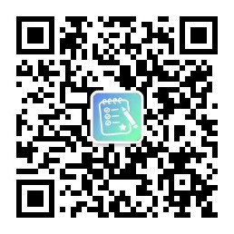

我儿子属于那种不喜欢学习、缺少主动性的佛系小少年。不争强，不好胜，考多少都行，考多少都那样。

为了**让他**能主动点，对学习提升点兴趣，我也没少想办法。

这么多年下来，我把能试的招都试了一遍。结论：都没用。

## 一、玩具

小学低年级时，我儿子特别喜欢各种工程车，慢慢地又迷上了武器类——枪、坦克、飞机。

我想，这算是被我抓住弱点了。考试成绩好了，就给买玩具。小考奖励小玩具，大考奖励大玩具。

开始答应的挺好，试了几次之后，他告诉我：“爸爸，我不喜欢玩具了。我也不要了。”

一句话，计划破产。

我还没来得及难过，他就给了我一个更狠的。

记得小学二年级开家长会，老师点名讲了我儿子的一个事。

小学考完试，还有一周左右才放假。这段时间，老师会让孩子们带自己喜欢的课外书去学校，互相交换着看。

有一天，老师让孩子们抄写自己带的课外读物里优美的句子。

我儿子站起来说：“老师，我的书里没有优美的句子。”

老师问：“你把你的书拿过来我看看。”

都是他从图书馆借的手枪、坦克、飞机的图画书。文字全是对武器的介绍。

老师在家长会上说，男孩子喜欢武器、有自己的兴趣爱好，没有问题，但也不能太单一，建议也给孩子准备几本名著看看。

家长哄堂大笑，我坐在底下，面带微笑，一声没吭。

## 二、卡片

小学高年级时，班上孩子开始玩各种卡片。第五人格，一小包里能抽出一两张高级卡。曾经一段时间特别迷。

这不，又被我发现弱点了。我说，买卡行，看考试成绩呗。

各科成绩任何一科比上次提升 5 分，奖励一包（10 张）第五人格。

我偷摸买了两盒（20 包）藏起来。每次考完试，只要成绩稍微有提升，我就变着法子奖励一包。

满心以为能持续地“诱惑”他。没想到一学年还没结束，孩子们都不玩了。

他也不玩了。这个奖励计划，又泡汤了。

## 三、球鞋

就这么不知不觉地上了初中。初中，孩子大了，兴趣也跟着变了——球鞋。

篮球鞋、足球鞋、跑步鞋、运动鞋。每个品牌的最新款、特点、材质，门儿清。比我懂多了。

弱点又来了，我也得跟上，赚钱买吧。

规则是这么定的：小考卷优秀 10 元，大卷优秀 30 元，优秀按 90 分以上算。

他们每天、每周的考试特别多，卷子一摞一摞的。很快，他对这个来兴趣了。

没到一个月，就攒了 300 多元。周末他开心地去商场选鞋，结果看上的都买不起。

看着他失落的样子，我说：“可以贷款，贷多少都行，付 20% 的利息就行。”

这个激励持续了很长时间。只是攒钱的周期越来越长，他也没什么新鲜感了。

按部就班地学习、考试——能得奖励最好，得不了也没什么期待的。

因为他知道，想赚一双自己最喜欢的鞋，需要付出太多。慢慢地，这个奖励也就不了了之了。

## 四、游戏

从初二开始，就开始打游戏了。地平线、篮球、足球，最近是三角洲。

本来我也想着，用成绩换游戏时间。但是这么多年了，能想到的招都想了，也试了。

依然没有激发出学习的兴趣。初中最后一年了，我也不想再费心了。

老师留的作业都完成了，你就玩会儿吧，每次别超过 1 小时就行。妥协了。

## 五、我不追了

现在我不追了。我不是放弃了，我是认了。

我认的是：他可能真的不是一个会为分数激动的孩子。

这么多年下来，他的兴趣一直在变，我一直在追。他喜欢什么，我就拿什么当奖励。

工程车、卡片、球鞋、游戏时间——每一件都是他喜欢的，没有一件是学习本身。

我用一个他喜欢的东西，去换他本来不愿做的事。

因为它从来不会自己带来快乐，快乐永远在它后面，是那双鞋、那包卡、那一个小时游戏时间。

但我还是想试试一件事——不是用奖励把他往前推，而是让他自己往前走一步，哪怕很小。

比如那天他做一道取值范围，卡住了，抬头看了一眼墙上的图，然后写了三个字：“第一种。”

那写下“第一种”三个字时的快乐，是奖励换不来的。因为那是他自己做到的。

---

📮 这篇的公众号原文 👉 [点击查看](https://mp.weixin.qq.com/s/wg_d0qyx81qrcUtgBXu8yw) ｜ 微信搜一搜「**作业不慌记**」关注更多陪学日常。

